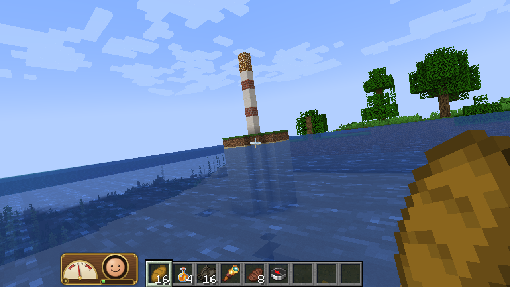
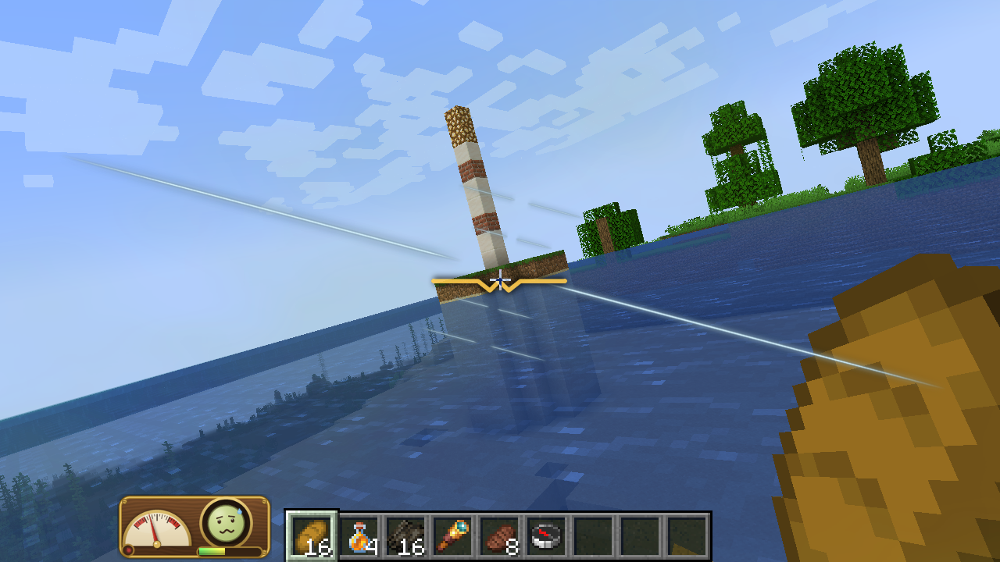
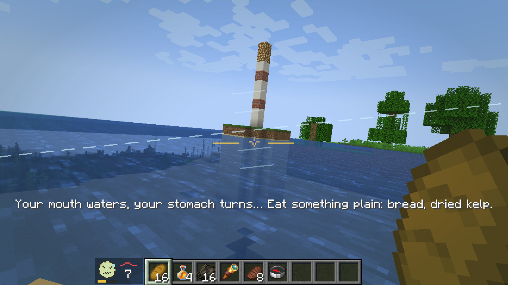
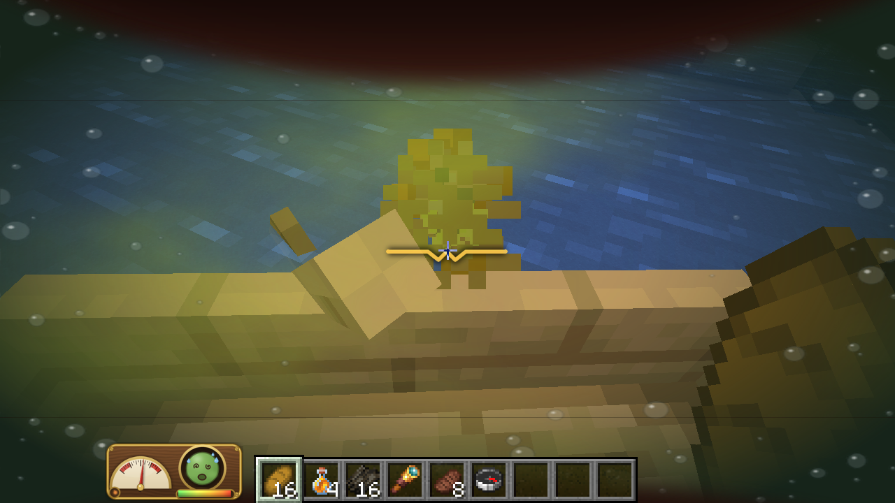
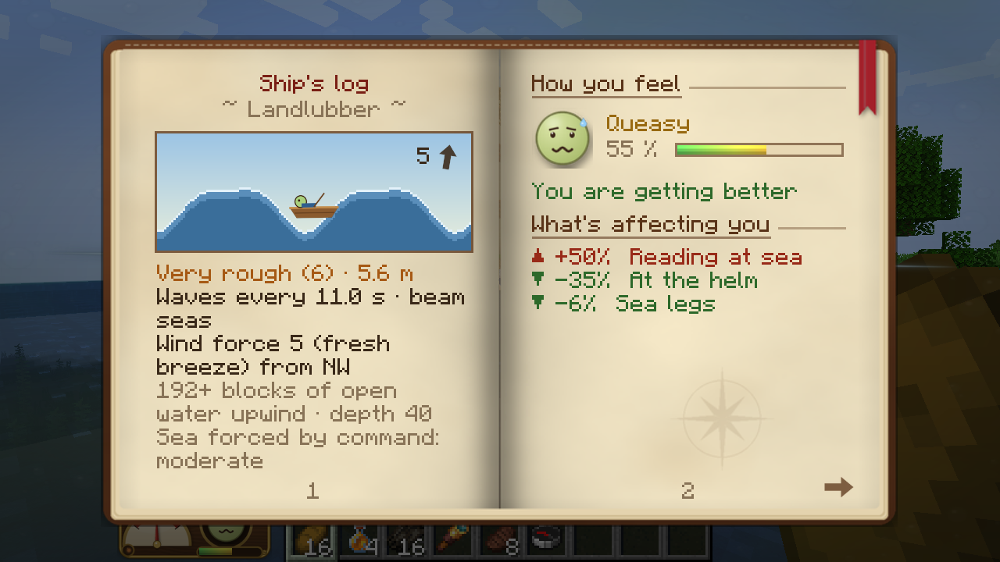

# 🌊 Seasick — le mal de mer, pour de vrai

> *Gardez les yeux sur l'horizon.*

Dans Minecraft, on traverse l'océan en tempête sans sourciller. **Seasick** donne enfin un estomac à votre personnage.

La mer est **simulée** à partir du vent, de la météo, de l'eau libre au vent, du fond et du biome ; votre bateau roule, tangue et pilonne comme un vrai ; et votre corps réagit aux mouvements comme un vrai, selon la **pondération du mal des transports de la norme ISO 2631-1**. Regarder l'horizon, tenir la barre, manger du sec… ou se pencher par-dessus bord.

**Mod 100 % client** : il fonctionne en solo et sur n'importe quel serveur, même vanilla. Rien ne change pour les autres joueurs.

## 📦 Installation

1. Choisissez le jar qui correspond à votre jeu (dans les [Releases](https://github.com/Loup0007A/seasick-mod/releases), sur CurseForge ou dans [`releases/`](releases/)) :

   | Minecraft | Loader | Jar |
   |---|---|---|
   | 1.21 – 1.21.1 | Forge 51+ | `seasick-<version>-forge-1.21.1.jar` (`seasick-latest-forge-1.21.1.jar`) |
   | 1.21 – 1.21.1 | NeoForge 21.0 / 21.1 | `seasick-<version>-neoforge-1.21.1.jar` (`seasick-latest-neoforge-1.21.1.jar`) |
   | 1.20.1 | Forge 47 | `seasick-<version>-forge-1.20.1.jar` (`seasick-latest-forge-1.20.1.jar`) |
   | 26.3 | NeoForge 26.3 | `seasick-<version>-neoforge-26.3.jar` (`seasick-latest-neoforge-26.3.jar`) — Java 25, OpenGL ou Vulkan |

2. Copiez-le dans le dossier `mods/` de votre installation (côté client uniquement).

## 🌬 La mer

- **Le vent** suit la météo : une brise changeante par beau temps (force 2 à 5), un vent frais sous la pluie (5 à 7), un coup de vent dans l'orage (8 à 10). Il tourne lentement, et souffle de la même façon pour tous ceux qui ont le mod.
- **La houle** se lève avec le vent (Pierson–Moskowitz : Hs ≈ 0,0214·U², période ≈ 0,73·U), mais seulement s'il y a assez d'**eau libre au vent** : un lac reste plat, le grand large se creuse. Elle **déferle sur les hauts-fonds** (pas plus de 0,6 fois le fond), s'amortit dans les rivières, les marais et sous la **banquise**, et disparaît **sous un toit**.
- **Votre bateau** roule, tangue, embarde et pilonne selon l'**allure** : mer de travers = roulis, mer de face = tangage et coups de bélier, vent arrière = longues glissades. À pleine vitesse face aux vagues, on les croise bien plus souvent (fréquence de rencontre). Les vagues arrivent **par séries** : environ une sur sept est plus grosse. La coque craque au bout du roulis.
- L'état de la mer suit l'**échelle de Douglas** (de « calme » à « énorme »), le vent l'**échelle de Beaufort**.

## 🤢 Le mal de mer

Le mal des transports vient d'un **conflit entre l'oreille interne et les yeux**. Le mod calcule une « dose » à partir des accélérations ressenties, pondérées comme le fait la norme ISO 2631-1 (on est le plus malade vers 0,1–0,25 Hz, la houle typique), et le corps récupère avec le temps. **Chaque situation a donc son équilibre** : quelqu'un qui se tient bien peut traverser une tempête sans être malade.

| Ce qui aide | Ce qui aggrave |
|---|---|
| 👁 Les yeux sur l'**horizon** (−45 %) | 📖 **Lire** en mer : inventaire, coffres, chat, panneaux (+50 %), un **livre** (+90 %) |
| ⛵ Tenir la **barre** : celui qui pilote anticipe (−35 %) | 🗺 Le nez dans une **carte** (+60 %) |
| 😑 **Fermer les yeux**, touche `Z` maintenue (−55 %) | 🔭 La **longue-vue** (+120 %) |
| 🍞 Manger **sec** : pain, biscuit, algues séchées, pomme de terre (−25 %) | 👞 Fixer **ses pieds** (+35 %), un **mur** tout proche (+30 %) |
| 🍯 Une fiole de **miel**, notre gingembre (−40 %) | 🧍 Être **passager** (+25 %) |
| 🧭 L'**horizon artificiel** quand le vrai a disparu (−15 %) | 🍖 Un repas **lourd** ou **cru** (+35 %), le **lait** (+25 %), du **gâté** (+50 %) |
| 🧂 Le **pied marin** (jusqu'à −60 %) | 🫙 L'**estomac vide** (+30 %), la **nuit** sans horizon (+15 %), la **nausée** (+80 %) |

### Les stades

| Stade | Ce que vous ressentez |
|---|---|
| 😊 En forme | Rien. |
| 😐 Barbouillé | On bâille, les paupières tombent (somnolence du mal des transports). |
| 🤢 Nauséeux | Teint pâle, on salive, sueurs froides. |
| 🤮 Malade | Sueurs froides sur les bords de l'écran, l'estomac gargouille, les mains tremblent, les rames glissent. |
| 😵 Au bord du malaise | … |

### Le moment fatidique

Deux haut-le-cœur vous préviennent : c'est le moment de **vous pencher par-dessus bord** (tournez-vous vers le côté et regardez en bas). Penché, c'est propre et le soulagement est plus grand. Sinon… c'est dans le bateau. Ce qui ressort a la couleur de votre **dernier repas** (les baies lumineuses brillent). Ensuite, quelques secondes de **soulagement**… puis, si rien ne change, ça recommence — à sec, cette fois.

## 🧂 Pied marin et mal de débarquement

- **Le pied marin** : le temps passé en mer (surtout quand elle est formée) vous endurcit peu à peu, de **Terrien** à **Mousse**, **Matelot**, **Marin aguerri** puis **Loup de mer**. Il se perd lentement après de longs séjours à terre.
- **Le mal de débarquement** : après une longue traversée, **le sol continue de tanguer** un moment, et votre marche dérive.
- **Les dromadaires**, vaisseaux du désert, vous bercent aussi.

## 📓 Le journal de bord (`O`)

L'état de la mer (Douglas, hauteur, période, allure), le vent (Beaufort, direction), l'eau libre et le fond ; votre malaise et **tout ce qui joue en ce moment, avec son effet** ; une **prévision** (« si rien ne change : malade dans 1:20 ») ; vos souvenirs (temps en mer, distance, traversées, malaises, plus longue traversée sans être malade). Attention : le lire en mer compte comme de la lecture.

## ⚙ Réglages et confort

`config/seasick-client.toml` :

- **Mal de mer** : `enabled`, `susceptibility` (0,25 = estomac de fer, 3 = très sensible), `creativeImmune`, `seaLegs`, `seaLegsRate`, `landSickness`, `camels`.
- **Confort** : `motionScale` (force des mouvements de caméra), `reduceMotion` (caméra immobile : la mer est montrée par l'horizon artificiel et la jauge), `swayAim` (le tangage bouge la visée ou seulement l'image), `screenEffects`, `grossEffects` (particules et sons quand on est malade), `affectControls` (tremblements, rames, se pencher), `artificialHorizon` (`OFF`, `ASSIST`, `ALWAYS`).
- **Interface** : `hud` (`HOTBAR_LEFT`, `TOP_LEFT`, `TOP_RIGHT`, `HIDDEN`), `messages`, `sounds`.

Commandes client : `/seasick status`, `/seasick logbook`, `/seasick sea <calm|slight|moderate|rough|storm|phenomenal|auto>`, `/seasick set <0-100>`, `/seasick sealegs <0-100>`, `/seasick vomit`, `/seasick landsick`, `/seasick reset`.

> ⚠ Ce mod fait **bouger l'image** exprès. Si vous êtes sensible au mal des transports *dans la vraie vie*, activez `reduceMotion` ou baissez `motionScale`.

## 🛠 Développement

Même organisation que [Fate Flip](https://github.com/Loup0007A/fate-flip) : `src/main` est la variante Forge 1.21.1, les autres cibles sont produites par `python3 tools/port.py <cible>` (voir [`CLAUDE.md`](CLAUDE.md)). `tools/model.py` reproduit le modèle physique hors jeu pour régler les constantes. La CI compile les quatre jars, lance pour chacun un vrai serveur et un vrai client (Forge 1.21 et 1.21.1, NeoForge 1.21.1, Forge 1.20.1, NeoForge 26.3 en OpenGL et en Vulkan) qui prennent la mer et photographient chaque état, puis publie la release et l'envoie sur CurseForge.

Licence MIT.
