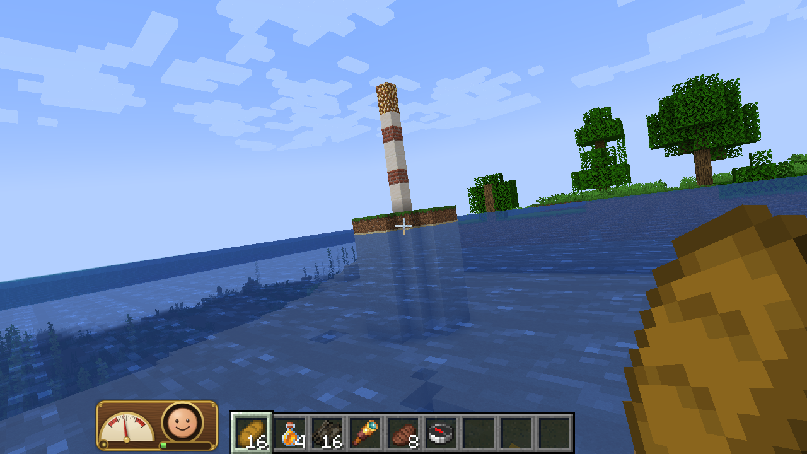
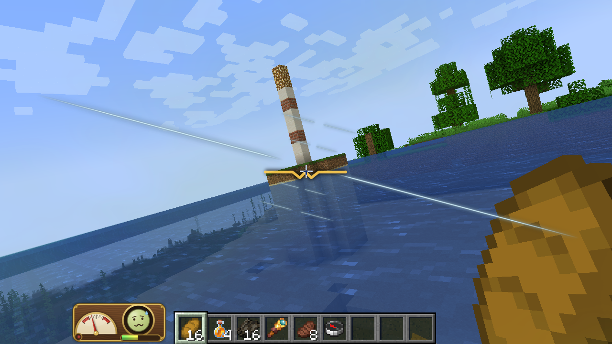
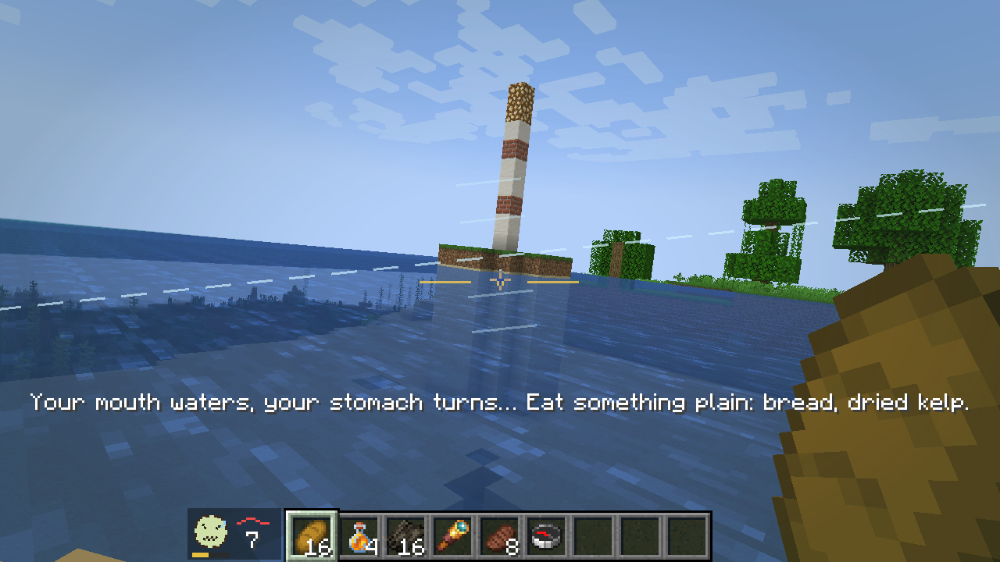
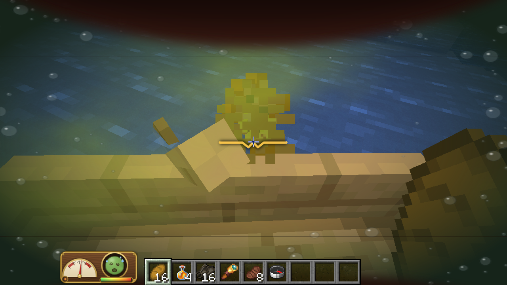
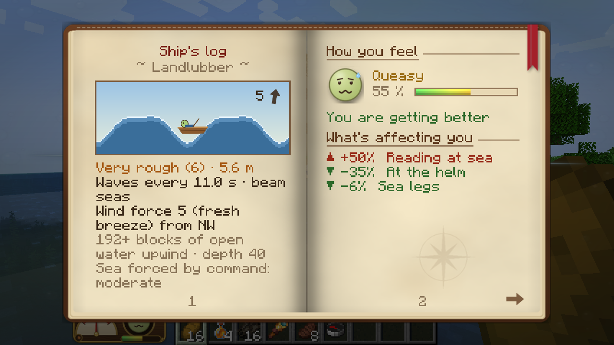

# Fiche CurseForge — textes prêts à copier

## Name

Seasick — Keep Your Eyes on the Horizon

## Summary

Real motion sickness at sea. Simulated waves, a boat that rolls and pitches, and a stomach that reacts like yours. Look at the horizon, take the helm… or lean over the side.

## Description (Markdown)

### In Minecraft you can cross a storm-tossed ocean without blinking. Not anymore.

**Seasick** gives your character a stomach. The sea is **simulated** from the wind, the weather, the open water upwind, the depth and the biome; your boat **rolls, pitches and heaves** like a real one; and your body reacts to that motion the way real bodies do, using the **motion-sickness weighting of the ISO 2631-1 standard**.

Look at the horizon. Take the helm. Eat something plain. Or lean over the side.

**100% client-side**: works in singleplayer and on any server, even vanilla ones. Nothing changes for other players.

### 🌬 A sea worth sailing
- **Wind** follows the weather — a shifting breeze when clear, fresh wind in the rain, a gale in thunderstorms — and slowly turns.
- **Waves** grow with the wind (Pierson–Moskowitz), but only over enough **open water upwind**: a lake stays flat, the open ocean builds up. They **break over shallows**, die down in rivers, swamps and under **sea ice**, and vanish **under a roof**.
- **Your boat** answers to where the waves come from: **beam seas** roll you, **head seas** pitch you and slam the bow, **following seas** make you surf. Sail into the waves at full speed and you meet them far more often (encounter frequency). Waves come in **sets** — every seventh wave is bigger. The hull creaks at the end of each roll.
- Sea state on the **Douglas scale**, wind on the **Beaufort scale**.

### 🤢 A stomach that reacts like yours
Motion sickness comes from a conflict between your **inner ear** and your **eyes**. Seasick turns the accelerations you feel into a sickness dose (most nauseating around 0.1–0.25 Hz — exactly ocean swell) while your body slowly recovers. **Every situation has its own balance**: play it smart and you can ride out a storm.

**What helps:** eyes on the **horizon** (−45%) · taking the **helm** — whoever steers anticipates the motion (−35%) · **closing your eyes**, hold `Z` (−55%) · something **plain** to eat: bread, cookies, dried kelp (−25%) · a **honey bottle**, our ginger (−40%) · an **artificial horizon** when the real one is gone · your **sea legs** (up to −60%).

**What hurts:** **reading** at sea — inventory, chests, chat, signs (+50%), a **book** (+90%), a **map** (+60%) · the **spyglass** (+120%) · staring at your **feet** (+35%) · being a **passenger** (+25%) · **heavy**, **raw** or **spoiled** food, **milk** · an **empty stomach** · **darkness** with no horizon · **Nausea**.

### Five stages
😊 **Fine** → 😐 **Uneasy** (yawns, heavy eyelids) → 🤢 **Queasy** (pale, mouth watering, cold sweat) → 🤮 **Sick** (dark edges, churning stomach, trembling hands, slipping oars) → 😵 **About to be sick**.

### The moment of truth
Two heaves warn you: **lean over the side** (turn sideways and look down). Over the rail it's clean and you feel much better. Otherwise… it's in the boat. It comes out the colour of your **last meal** (glow berries glow). Then a little **relief**… and if nothing changes, it starts again — dry heaves this time. *(Gross effects can be turned off.)*

### 🧂 Sea legs & land sickness
- **Sea legs**: time at sea slowly hardens you, from **Landlubber** to **Deckhand**, **Sailor**, **Old Salt** and **Sea Dog**. Long stays ashore wear it off.
- **Land sickness** (*mal de débarquement*): after a long voyage, **the ground keeps swaying** for a while and your walk drifts.
- **Camels**, the ships of the desert, rock you too.

### 📓 Ship's log (`O`)
Sea state, waves, wind and open water; how you feel and **everything affecting you right now, with its exact effect**; a **forecast** ("if nothing changes: sick in 1:20"); and your memories at sea. Careful: reading it at sea counts as reading.

### ⚙ Comfort & configuration
This mod moves the picture **on purpose**. If you get motion sick in real life, turn on `reduceMotion` (still camera — the sea is shown by the artificial horizon and the gauge) or lower `motionScale`.

`config/seasick-client.toml`: `susceptibility`, `creativeImmune`, `seaLegs`, `seaLegsRate`, `landSickness`, `camels`, `motionScale`, `reduceMotion`, `swayAim`, `screenEffects`, `grossEffects`, `affectControls`, `artificialHorizon`, `hud`, `messages`, `sounds`.

Client commands: `/seasick status | logbook | sea <calm…phenomenal|auto> | set <0-100> | sealegs <0-100> | vomit | landsick | reset`.

### ✦ Requirements
Client only. One jar per version (pick the matching file on the Files tab):
- Minecraft **1.21 – 1.21.1**, **Forge 51+** or **NeoForge 21.0 / 21.1**, Java 21
- Minecraft **1.20.1**, **Forge 47**, Java 17
- Minecraft **26.3**, **NeoForge 26.3**, Java 25 (OpenGL and Vulkan)

---

### 🇫🇷 En français
Dans Minecraft, on traverse l'océan en tempête sans sourciller. **Seasick** donne un estomac à votre personnage : la houle est simulée (vent, météo, eau libre au vent, fond, biome), le bateau roule, tangue et pilonne selon l'allure, et le mal de mer suit la pondération de la norme ISO 2631-1. Regardez l'horizon, tenez la barre, fermez les yeux, mangez du sec ou du miel… ou penchez-vous par-dessus bord. Cinq stades, pied marin (de Terrien à Loup de mer), mal de débarquement, dromadaires, journal de bord avec prévision, horizon artificiel et réglages de confort. Mod 100 % client, entièrement traduit en français.

Source code & issues: https://github.com/Loup0007A/seasick-mod — MIT licence.
